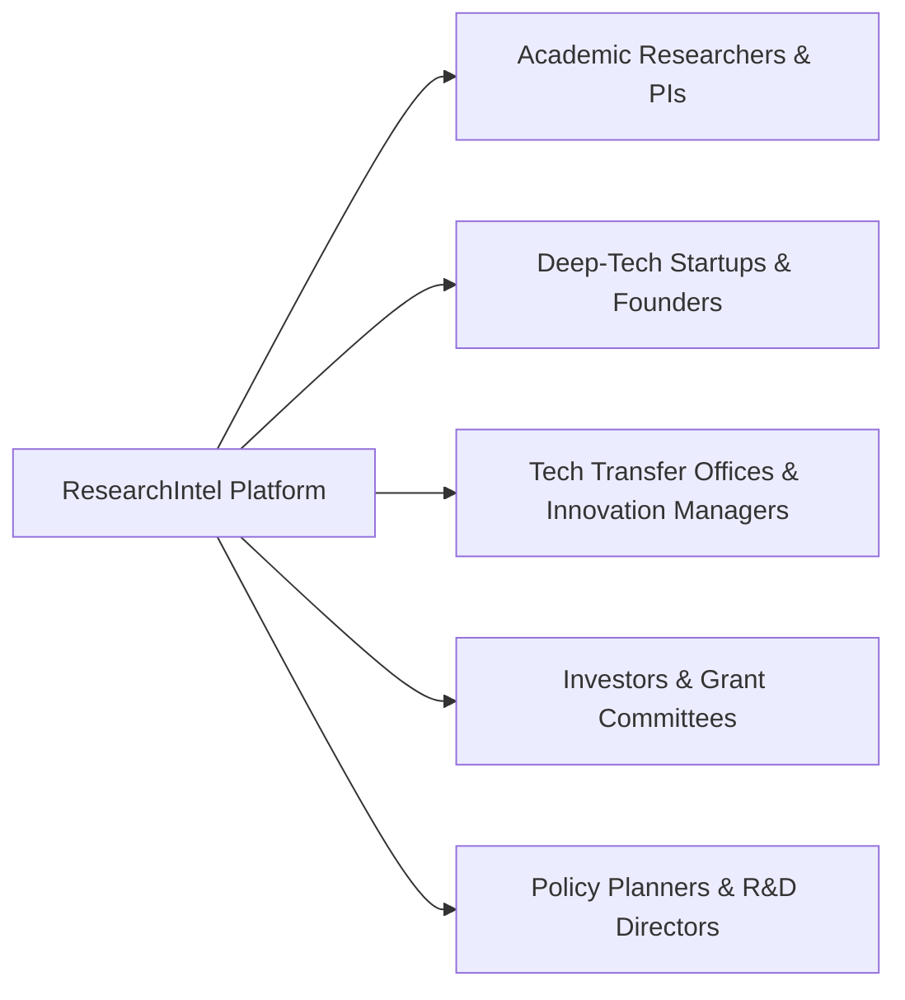

# 🔬 ResearchIntel — Research Funding & Innovation Intelligence Platform

[](https://www.python.org/)
[](https://fastapi.tiangolo.com/)
[](https://react.dev/)
[](https://vitejs.dev/)
[](https://threejs.org/)
[](https://www.postgresql.org/)
[](https://groq.com/)
[](LICENSE.txt)

> **ResearchIntel** is an enterprise-grade AI-powered intelligence platform that unifies global scholarly publications, patent registries, grant funding opportunities, technology maturity tracking, and explainable innovation assessment into a single real-time decision-support system for researchers, university innovation managers, startups, and policy analysts.

---

## 📑 Table of Contents

- [Platform Overview](#-platform-overview)
- [What Makes ResearchIntel Different (Competitive Advantage)](#-what-makes-researchintel-different-competitive-advantage)
  - [The Silo Problem vs. Unified Intelligence](#the-silo-problem-vs-unified-intelligence)
  - [Feature Comparison Matrix](#feature-comparison-matrix)
  - [5 Foundational Differentiators](#5-foundational-differentiators)
- [How The Platform Helps You (Value by Persona)](#-how-the-platform-helps-you-value-by-persona)
  - [For Academic Researchers & Principal Investigators (PIs)](#for-academic-researchers--principal-investigators-pis)
  - [For Deep-Tech Startups & Innovators](#for-deep-tech-startups--innovators)
  - [For University Technology Transfer Offices (TTOs) & Innovation Managers](#for-university-technology-transfer-offices-ttos--innovation-managers)
  - [For Venture Capitalists, Investors & Grant Committees](#for-venture-capitalists-investors--grant-committees)
  - [For Policy Makers & National R&D Planners](#for-policy-makers--national-rd-planners)
- [Real-World User Journeys & End-to-End Workflows](#-real-world-user-journeys--end-to-end-workflows)
  - [Journey 1: From Research Concept to Funded Grant in 15 Minutes](#journey-1-from-research-concept-to-funded-grant-in-15-minutes)
  - [Journey 2: De-risking a Patent Filing with 3D Spatial Clustering](#journey-2-de-risking-a-patent-filing-with-3d-spatial-clustering)
  - [Journey 3: Board-Ready Technology Intelligence Dossier Generation](#journey-3-board-ready-technology-intelligence-dossier-generation)
- [Comprehensive Module Architecture (Modules 1–11)](#-comprehensive-module-architecture-modules-111)
  - [Module 1: Enterprise Authentication & RBAC](#module-1-enterprise-authentication--rbac)
  - [Module 2: Researcher Profile & Academic Details](#module-2-researcher-profile--academic-details)
  - [Module 3: Multi-Source Research Intelligence](#module-3-multi-source-research-intelligence)
  - [Module 4: Funding Opportunity Intelligence & AI Semantic Matching](#module-4-funding-opportunity-intelligence--ai-semantic-matching)
  - [Module 5: Patent Landscape & 3D Cluster Visualization](#module-5-patent-landscape--3d-cluster-visualization)
  - [Module 6: Technology Intelligence & Empirical Maturity Engine](#module-6-technology-intelligence--empirical-maturity-engine)
  - [Module 7: Explainable Weighted Innovation Scoring Engine](#module-7-explainable-weighted-innovation-scoring-engine)
  - [Module 8: Commercialization & Translational Pathway Analysis](#module-8-commercialization--translational-pathway-analysis)
  - [Module 9: Role-Based Command Dashboards](#module-9-role-based-command-dashboards)
  - [Module 10: Unified Multi-Source Dossiers & Live PDF Synthesis](#module-10-unified-multi-source-dossiers--live-pdf-synthesis)
  - [Module 11: Real-Time Notification Center & Grounded Platform AI Assistant](#module-11-real-time-notification-center--grounded-platform-ai-assistant)
- [Data Sources & Ingestion Pipeline](#-data-sources--ingestion-pipeline)
- [System Architecture & Tech Stack](#-system-architecture--tech-stack)
- [Directory Structure](#-directory-structure)
- [Getting Started & Installation](#-getting-started--installation)
  - [Prerequisites](#prerequisites)
  - [One-Click Docker Orchestration (Recommended)](#one-click-docker-orchestration-recommended)
  - [Local Backend Setup (FastAPI & PostgreSQL)](#backend-setup-fastapi--postgresql)
  - [Local Frontend Setup (React 19 & Vite)](#frontend-setup-react-19--vite)
  - [One-Click Demo Bootstrapper & Data Seeder](#one-click-demo-bootstrapper--data-seeder)
- [CI/CD & Automated Verification](#-cicd--automated-verification)
- [Live Demonstration Playbook & Pitch Guide](#-live-demonstration-playbook--pitch-guide)
- [Interactive API Testing & Postman Collection](#-interactive-api-testing--postman-collection)
- [Running Test Suites](#-running-test-suites)
- [API Endpoints Reference](#-api-endpoints-reference)
- [User Roles & Personas](#-user-roles--personas)
- [License](#-license)

---

## 🌟 Platform Overview

Bridging the gap between fundamental research and commercial market reality requires connecting disconnected data silos: academic papers, patent gazettes, government funding calls, and market adoption metrics. 

**ResearchIntel** harmonizes these signals:
- **13 scholarly providers** providing real-time paper discovery, structured extraction, and citation verification.
- **Global & Indian patent registries** (EPO Linked Open Data, PatentsView, and Indian Patent Office) analyzed via dense vector embeddings, KMeans clustering, and interactive 3D spatial projections.
- **Over 1,200 funding grants** dynamically matched to researcher profiles via vector cosine similarity.
- **Authoritative 5-factor deterministic Innovation Scoring** providing transparent, reproducible evaluations without LLM hallucinations.
- **Automated dossier generation** with live PDF export, role-tailored dashboards, and an evidence-grounded AI conversational assistant.

```mermaid
flowchart TD
    subgraph Data Layer
        A1[13 Scholarly Providers<br/>OpenAlex, PubMed, arXiv, etc.]
        A2[Patent Registries<br/>EPO, PatentsView, Indian IPO]
        A3[Grant Opportunities<br/>Grants.gov, NIH, CORDIS, DST]
    end

    subgraph Intelligence Engine
        B1[Dense Vector Embeddings<br/>Normalized 100k-dim semantic space]
        B2[KMeans & 3D PCA Projector]
        B3[Deterministic 5-Factor Scorer<br/>30% Novelty | 20% Patent | 15% Tech<br/>20% Market | 15% Funding]
        B4[AI Assistant & Grok Briefs<br/>Evidence-grounded synthesis]
    end

    subgraph Presentation & Role Dashboards
        C1[Researcher Dashboard]
        C2[Startup Founder Hub]
        C3[Innovation Manager Command]
        C4[Administrator Control Room]
        C5[Live PDF Export Engine]
    end

    Data Layer --> Intelligence Engine
    Intelligence Engine --> Presentation & Role Dashboards
```

---

## ⚡ What Makes ResearchIntel Different (Competitive Advantage)

### The Silo Problem vs. Unified Intelligence

Traditional R&D intelligence tools suffer from **severe isolation**:
- **Google Scholar / Semantic Scholar**: Track citations and academic text, but remain completely blind to corporate patent filings, grant deadlines, and commercial adoption.
- **PatSnap / Derwent / Lens**: Provide comprehensive patent analytics, but treat academic papers as secondary footnotes and lack live grant matching or automated TRL tracking.
- **Grants.gov / Pivot-RP**: List funding announcements, but lack semantic recommendation engines that read a researcher's publications to score matching relevance.
- **PitchBook / CB Insights**: Track venture funding, but omit deep peer-reviewed scientific claims and technical methodology deconstruction.
- **Generic LLM Chatbots (ChatGPT / Perplexity)**: Frequently hallucinate fake citations, invent non-existent grants, or produce non-reproducible subjective ratings.

**ResearchIntel breaks these silos.** It is built from the ground up as a **cross-intelligence engine**: a single query connects peer-reviewed papers $\rightarrow$ prior-art patent clusters $\rightarrow$ active non-dilutive grants $\rightarrow$ empirical innovation scores $\rightarrow$ commercialization pathways.

---

### Feature Comparison Matrix

| Feature / Capability | Google Scholar | Dimensions / Scopus | PatSnap | Generic AI Chatbots | **ResearchIntel** 🚀 |
| :--- | :---: | :---: | :---: | :---: | :---: |
| **Unified Cross-Domain Graph** (Papers + Patents + Grants) | ❌ | Partial (Papers + Patents) | Partial (Patents focused) | ❌ (Unstructured text) | **✅ Fully Unified Cross-Flow** |
| **Scholarly Aggregator Pipeline** | Single Index | Proprietary / Paywalled | Limited | Web scraping | **✅ 13 Academic Providers Open Access** |
| **Auto-Discovery Scholarly Ingest** | ❌ | ❌ | ❌ | ❌ | **✅ Live Trigger (<20 record fallback)** |
| **Structured AI Paper Deconstruction** | ❌ | ❌ | ❌ | Unverified LLM summary | **✅ 5-Point Structured Extraction** |
| **Semantic Grant Profile Matching** | ❌ | Partial Keyword Match | ❌ | ❌ | **✅ Dense Cosine Similarity (1,200+ Grants)** |
| **Interactive 3D Spatial Landscapes** | ❌ | Flat 2D Charts | 2D Landscapes | ❌ | **✅ Three.js WebGL 3D Spatial Cluster Map** |
| **Patent Novelty & Idea Gap Analyzer** | ❌ | ❌ | Expensive Enterprise | Hallucinated text | **✅ "Check Your Innovation" Idea Analyzer** |
| **Deterministic Innovation Scoring** | ❌ | ❌ (Subjective Altmetrics) | ❌ | ⚠️ Hallucinates fake scores | **✅ 5-Factor Verified Deterministic Formula** |
| **National Indian Innovation Inclusion** | Partial | Partial | ❌ | ❌ | **✅ Indian Patent Office (IPO) + DST/ICMR/SERB** |
| **Instant Executive PDF Dossier** | ❌ | Export raw CSV | Export raw PDF | Copy-paste text | **✅ One-Click Synthesized ReportLab PDF** |
| **Grounded Platform AI Assistant** | ❌ | ❌ | Separate Add-On | Hallucinates sources | **✅ Strictly Context-Grounded Grok/Groq Inference** |

---

### 5 Foundational Differentiators

#### 1. Deterministic Mathematical Formulation (No Hallucinated Scores)
> [!IMPORTANT]
> In ResearchIntel, **no Large Language Model is ever permitted to compute or adjust numerical scores.**
> All evaluations are derived through transparent, reproducible mathematical equations:
> $$\text{Score} = (\text{Novelty} \times 0.30) + (\text{Patents} \times 0.20) + (\text{Maturity} \times 0.15) + (\text{Market} \times 0.20) + (\text{Funding} \times 0.15)$$
> LLMs are restricted strictly to evidence translation, structured summarization, and interactive Q&A grounded in verified database entities.

#### 2. Live 13-Provider Multi-Source Auto-Discovery Pipeline
Instead of relying on a static, stale database, ResearchIntel queries 13 premier open scientific registries concurrently:
`OpenAlex`, `Crossref`, `Semantic Scholar`, `CORE`, `arXiv`, `Europe PMC`, `PubMed`, `DOAJ`, `OpenAIRE`, `Zenodo`, `bioRxiv`, `medRxiv`, and `BASE`.
If a specialized topic search returns fewer than 20 records in the local database, the system **automatically triggers live external discovery**, harvesting, deduplicating, and indexing the latest papers on the fly.

#### 3. Interactive WebGL 3D Spatial Topologies vs. Flat Tables
Rather than scrolling through thousands of text rows, researchers and IP lawyers explore patent clusters via an interactive Three.js 3D spatial landscape. High-dimensional vector spaces are projected via PCA (Principal Component Analysis) into 3D coordinate space, visually exposing **dense patent thickets**, **competitive cluster boundaries**, and **open technological whitespace**.

#### 4. Deep Indian Innovation Integration + Global Registries
Most global intelligence tools disproportionately index Western databases while ignoring Indian national research momentum. ResearchIntel natively indexes **Indian Patent Office (IPO) records**, **Department of Science & Technology (DST)** grants, **Indian Council of Medical Research (ICMR)** funding, and **SERB** programs alongside global datasets from EPO, USPTO, and NIH.

#### 5. Actionable Commercialization & TRL Acceleration
ResearchIntel doesn't stop at literature analysis; it translates discoveries into market action:
- Automated **Technology Readiness Level (TRL 1–9)** estimation.
- University spin-off potential and translational readiness evaluations.
- Target industry vertical classification and non-dilutive grant identification before equity dilution.

---

## 🎯 How The Platform Helps You (Value by Persona)



### For Academic Researchers & Principal Investigators (PIs)
- **Never Miss High-Value Grants**: Stop manual keyword searches across fragmented portals. Your profile automatically scans 1,200+ funding calls, ranking matching grants by cosine semantic relevance with clear eligibility badges.
- **Accelerate Literature Reviews**: Deconstruct dense 30-page publications in seconds into structured problems, methodologies, findings, limitations, and future directions.
- **Find Open Whitespace Before You Write**: Avoid spending months drafting a grant proposal in a saturated domain by identifying uncrowded research gaps first.
- **Verified DOI Citations**: Ensure academic integrity with automated citation verification against Crossref and OpenAlex.

### For Deep-Tech Startups & Innovators
- **De-Risk Patent Filings ("Check Your Innovation")**: Input your technical concept into the Patent Idea Analyzer. Within seconds, discover overlapping claims, potential infringement risks, and defensible whitespace angles.
- **Secure Non-Dilutive Capital**: Discover government grants (DST, ICMR, NIH, CORDIS) aligned with your technology stack before giving away company equity to venture capital.
- **Commercialization Pathway Guidance**: Assess your current Technology Readiness Level (TRL) and map regulatory and market entry barriers.

### For University Technology Transfer Offices (TTOs) & Innovation Managers
- **Portfolio Health & Maturity Monitoring**: Track faculty research outputs, active patent filings, and licensing readiness across university departments in one centralized dashboard.
- **Technology Comparison Radars**: Evaluate 2 to 5 emerging technologies side-by-side to prioritize institutional funding and patent filing budgets.
- **Audit-Ready Board Dossiers**: Generate and download comprehensive, branded PDF dossiers with executive summaries, S-curves, and tabular evidence ready for deans, leadership, or government auditors.

### For Venture Capitalists, Investors & Grant Committees
- **Grounded Technical Due Diligence**: Validate startup pitch deck claims against real publication volume, verified patent assignees, and clinical or empirical citations.
- **True Technology Maturity Assessment**: Replace subjective hype with 6-indicator S-curve progression to distinguish foundational breakthroughs from transient marketing noise.
- **Spot Emerging Convergence**: Detect cross-domain technology convergence (e.g. Generative AI applied to Molecular Biology) early.

### For Policy Makers & National R&D Planners
- **Monitor National Research Momentum**: Track longitudinal patent activity and research volume (2018–2026) across critical technological domains like Quantum Computing, Green Hydrogen, and Clean Energy.
- **Identify Underfunded Strategic Gaps**: Locate high-impact research areas with low funding inflows to guide targeted national grant allocation.

---

## 🔄 Real-World User Journeys & End-to-End Workflows

### Journey 1: From Research Concept to Funded Grant in 15 Minutes
1. **Profile Setup**: A biomedical researcher logs in with Google OAuth or email and inputs their research domain: *"Deep learning for early-stage brain tumor segmentation on 3D MRI scans"*.
2. **Scholarly Intelligence**: They visit the **Research Papers** module. The platform automatically aggregates papers from arXiv, PubMed, and Europe PMC, providing structured breakdowns of current 3D U-Net limitations.
3. **Semantic Grant Matching**: In the **Funding Intelligence** module, the system computes cosine vector similarities against 1,200+ grant records.
4. **Targeted Match**: The platform flags an active DST/ICMR grant: *"AI-Driven Clinical Diagnostic Frameworks"* with a **94.8% Match Score**, highlights overlapping keywords, confirms eligibility, and alerts that the deadline is in 28 days.
5. **Action**: The researcher bookmarks the grant, reviews the required deliverables, and drafts the proposal targeting the verified gaps.

### Journey 2: De-risking a Patent Filing with 3D Spatial Clustering
1. **Concept Submission**: A roboticist develops a novel tactile feedback sensor for surgical robotic arms and opens **"Check Your Innovation"** in the Patent module.
2. **Dense Vector Matching**: The engine encodes the concept and queries 10,000+ patents across EPO, PatentsView, and Indian Patent Office registries.
3. **3D Landscape Exploration**: The 3D Three.js scatter map renders the surgical robotics cluster. The user's idea appears as an interactive coordinate node.
4. **Whitespace Identification**: The engine alerts that while *kinematic robotic arm control* has dense patent thickets (50+ corporate assignees), *low-latency piezoelectric tactile feedback* has a significant whitespace gap.
5. **Outcome**: The founder modifies their patent claims to emphasize the tactile feedback mechanism, significantly increasing patent grant probability and avoiding prior-art rejection.

### Journey 3: Board-Ready Technology Intelligence Dossier Generation
1. **Technology Selection**: An Innovation Manager at a research university needs to present a strategic briefing on **Synthetic Biology & Metabolic Engineering** to the board.
2. **Multi-Source Synthesis**: In the **Reports** module, they select Synthetic Biology and trigger automated synthesis.
3. **Data Aggregation**: The backend queries Modules 3, 4, 5, and 6, compiling publication volume trends, corporate assignee distributions, active grant sums, and the 5-factor innovation score.
4. **AI Executive Summary**: Groq/Grok AI synthesizes evidence-grounded key takeaways, strongest innovation signals, and market barriers.
5. **Instant Export**: The manager clicks **Download Official PDF Report**. A formatted, multi-page vector PDF with tables, radar charts, and source citations is downloaded instantly.

---


## 🧩 Comprehensive Module Architecture (Modules 1–11)

### Module 1: Enterprise Authentication & RBAC
- **Password Security**: Argon2 hashing via `pwdlib` with salt randomization.
- **Tokens**: JWT (JSON Web Tokens) with cryptographically signed HS256 claims, expiry management, and refresh cycles.
- **OAuth2**: Google OAuth2 integration (`/auth/oauth/google` and `/auth/oauth/google/callback`) with state verification cookies.
- **Role-Based Access Control (RBAC)**: Enforced via FastAPI dependency guards (`require_roles(...)` and `get_current_user_optional`):
  - `researcher`: Academic profile tracking, recommendations, citation analysis.
  - `startup_founder`: Technology adoption velocity, market whitespace, commercialization pathways.
  - `innovation_manager`: Portfolio monitoring, maturity analysis, multi-technology comparisons.
  - `administrator`: Multi-tenant corpus ingestion, user management, and provider diagnostics.
  - `investor`, `innovator`, `reviewer`: Custom access scopes.

### Module 2: Researcher Profile & Academic Details
- Comprehensive profile model capturing:
  - Affiliation, department, designation, contact, country, and primary research domain.
  - Granular **Research Areas**, **Keywords**, **Technology Areas**, and linked **Publications** & **Patents**.
  - Dynamic profile synthesis text used by semantic matching engines to personalize intelligence across the platform.

### Module 3: Multi-Source Research Intelligence
- **13 Unified Scholarly Providers**: OpenAlex, Crossref, Semantic Scholar, CORE, arXiv, Europe PMC, PubMed, DOAJ, OpenAIRE, Zenodo, bioRxiv, medRxiv, and BASE.
- **Live Auto-Discovery Trigger**: Automatically queries external scholarly APIs when a user search yields fewer than 20 local records, indexing new papers in the background.
- **Automated AI Paper Analysis**: Deconstructs any paper into:
  - Core Research Problem & Motivation
  - Proposed Methodology & Technical Approach
  - Key Findings & Quantitative Claims
  - Limitations & Constraints
  - Future Research Directions & Whitespace Gaps
- **Independent Citation Verification**: DOI and Crossref validation with citation counts and verified source badges.

### Module 4: Funding Opportunity Intelligence & AI Semantic Matching
- **Aggregated Grant Repositories**: Grants.gov, NIH RePORTER, European Commission CORDIS, and Indian Government Grant portals (DST, ICMR, SERB).
- **Personalized Semantic Matching**:
  - Encodes the user's research profile into dense semantic vector space.
  - Calculates cosine similarity against all active funding opportunities.
  - Generates transparent match confidence (`Strong Match`, `Relevant Match`, `Broad Match`).
  - Identifies overlapping technical keywords and automated eligibility checks (citizenship, career stage, organization type).
- **Scalable Pagination & Sorting**: Handles 1,200+ opportunities with multi-parameter filtering (agency, funding type, research domain, deadline, award ceiling).
- **Saved Opportunities & Bookmarking**: One-click saved grants tracking with status indicators.

### Module 5: Patent Landscape & 3D Cluster Visualization
- **Live Patent Ingestion**: Real-time European Patent Office (EPO) Linked Open Data SPARQL queries, USPTO PatentsView, and Indian Patent Office dataset.
- **Semantic Vectorization**: High-dimensional L2-normalized vectorization of title, abstract, and IPC classifications.
- **Unsupervised KMeans Clustering**: Automatic grouping of patents into thematic technology clusters with silhouette score quality evaluation and automated label generation.
- **WebGL 3D Landscape**: Interactive Three.js spatial scatter plot with orbital controls, cluster coloring, representative patent nodes, and 2D/3D PCA projection toggles.
- **"Check Your Innovation" (Patent Idea Analyzer)**:
  - Evaluates user-submitted technical concepts against patent databases.
  - Calculates novelty index, feature overlap, and identifies direct prior art.
  - Highlights whitespace opportunities and defensible differentiation avenues.

### Module 6: Technology Intelligence & Empirical Maturity Engine
- **Target Tracking Technologies**: Quantum Computing, Synthetic Biology, Clean Energy, Brain-Computer Interfaces, Space Tech, Generative AI, Edge AI, Medical Imaging AI, Smart Materials, Cybersecurity, Solid-State Batteries, and Green Hydrogen.
- **6-Indicator S-Curve Maturity Engine**:
  1. Scholarly Publication Velocity (Module 3)
  2. Patent Inventions Volume (Module 5)
  3. Active Corporate/Institutional Assignee Diversity
  4. Global & Indian Grant Funding Inflow (Module 4)
  5. Real-World Market Adoption & Industrial Integration
  6. Longitudinal Multi-Year Momentum
- **Longitudinal Trend Tracking**: Historical dataset evolution from 2018 to present day.

### Module 7: Explainable Weighted Innovation Scoring Engine
- **Deterministic 5-Factor Formulation**:
  $$\text{Innovation Score} = S_{\text{Novelty}} \times 0.30 + S_{\text{Patent}} \times 0.20 + S_{\text{Maturity}} \times 0.15 + S_{\text{Market}} \times 0.20 + S_{\text{Funding}} \times 0.15$$
- **Strict Boundary**: No LLM ever computes, alters, or hallucinates numerical scores; all scores are computed from verifiable database entities.
- **Missing Data Policy**: Dynamic re-normalization over available factor weights ensuring fair scoring across early-stage vs. mature technologies.
- **Comparative Multi-Tech Radar**: Side-by-side factor evaluation comparing 2 to 5 technologies simultaneously.

### Module 8: Commercialization & Translational Pathway Analysis
- Technology Readiness Level (TRL 1–9) estimation from multi-domain evidence.
- Spin-off and university startup readiness evaluation.
- Target industry vertical classification, licensing opportunities, and market barrier analysis.

### Module 9: Role-Based Command Dashboards
- **Researcher Command Center**: Publications count, citation indices, personalized grant matches, research topic heatmaps, and connected intelligence flow.
- **Startup Founder Hub**: Market gaps, prior art whitespace alerts, funding opportunity deadlines, and commercialization velocity metrics.
- **Innovation Manager Dashboard**: Portfolio-wide maturity indexes, multi-technology comparisons, and university patent filing trends.
- **Administrator Room**: Real-time multi-source provider status (OpenAlex, Crossref, EPO, PubMed, etc.), batch corpus ingester, and corpus growth targets.

### Module 10: Unified Multi-Source Dossiers & Live PDF Synthesis
- Comprehensive PDF dossier generation using Python's `reportlab` library:
  - Executive Summaries & Structured Findings
  - Radar and tabular indicator breakdowns
  - Prior art citations and active funding program tables
  - Full branding, vector headers, and professional page formatting
- Browser-based live preview document with instant download capabilities.

### Module 11: Real-Time Notification Center & Grounded Platform AI Assistant
- **Smart Notification Engine**: Alerts for new relevant funding calls, patent filings matching research topics, and technology maturity shifts.
- **Platform AI Assistant (`xAI Grok / Groq Fast Inference`)**:
  - Interactive analyst chatbot grounded strictly in live database entities.
  - "Ask an Analyst" concept questions with cited evidence.
  - Generates Grok Innovation Briefs with executive summaries, opportunity signals, and research gaps.

---

## 🌐 Data Sources & Ingestion Pipeline

| Domain | Primary Data Sources & Adapters | Protocol / Format | Features Supported |
| :--- | :--- | :--- | :--- |
| **Scholarly Papers** | OpenAlex, Crossref, Semantic Scholar, CORE, arXiv, Europe PMC, PubMed, DOAJ, OpenAIRE, Zenodo, bioRxiv, medRxiv, BASE | REST JSON, XML, OAI-PMH | Multi-source search, live auto-discovery trigger (<20 records), automated structured analysis, DOI citation verification |
| **Patents & IP** | European Patent Office (EPO), USPTO PatentsView, Indian Patent Office (IPO) | SPARQL Linked Open Data, REST APIs | Multi-concept extraction, KMeans clustering, 2D/3D PCA projection, idea whitespace analysis |
| **Funding Grants** | Grants.gov, NIH RePORTER, CORDIS (European Commission), DST / ICMR / SERB (India) | REST API, Web Ingestion | Vector cosine matching, eligibility filtering, deadline status, bookmarking |
| **Technologies** | Aggregated across Module 3, 4, 5 & Market Indices | Unified SQL Models | 6-indicator maturity S-curve, adoption velocity, longitudinal trend analysis |

---

## 🛠 System Architecture & Tech Stack

### Backend
- **Language**: Python 3.10+ (tested on Python 3.14)
- **Framework**: [FastAPI](https://fastapi.tiangolo.com/) with asynchronous endpoint handling
- **Database ORM**: [SQLAlchemy 2.0](https://www.sqlalchemy.org/) with [Alembic](https://alembic.sqlalchemy.org/) migrations
- **Database Driver**: `psycopg` (v3 binary) for PostgreSQL; in-memory SQLite support for unit testing
- **Machine Learning & Math**: `scikit-learn`, `numpy`, `scipy` (KMeans clustering, PCA spatial projection, L2-normalized vectorization)
- **Document Synthesis**: `reportlab` (Dynamic enterprise PDF generation)
- **AI / LLM Integration**: [Groq Cloud SDK](https://console.groq.com/) (`openai/gpt-oss-120b`, Llama-3-70b)
- **Security & Cryptography**: `pwdlib[argon2]`, `PyJWT`

### Frontend
- **Framework**: [React 19](https://react.dev/) + [Vite 8](https://vitejs.dev/)
- **Routing**: [React Router v7](https://reactrouter.com/)
- **3D Graphics & Data Visualization**: [Three.js](https://threejs.org/) for interactive WebGL 3D patent cluster landscapes
- **Styling Architecture**: Custom CSS design system with CSS custom properties, glassmorphism, responsive viewports, and micro-animations

---

## 📂 Directory Structure

```text
Intelligent-Research4/
├── backend/
│   ├── alembic/                      # Database migration scripts
│   ├── app/
│   │   ├── auth/                     # JWT security, dependencies, and OAuth2 router
│   │   ├── database/                 # Connection pools, engine, and base models
│   │   ├── models/                   # SQLAlchemy declarative models (User, Patent, Paper, etc.)
│   │   ├── routers/                  # Modular FastAPI routers
│   │   │   ├── assistant.py          # Platform AI assistant & analyst Q&A
│   │   │   ├── commercialization.py  # Commercialization & TRL assessment
│   │   │   ├── dashboard.py          # Role-based dashboard aggregations
│   │   │   ├── funding_opportunity.py# Grants search, sync, and recommendations
│   │   │   ├── innovation_assessment.py # Deterministic Innovation Scoring API
│   │   │   ├── notifications.py      # Real-time notifications & preferences
│   │   │   ├── patent.py             # Patent search, EPO import, and 3D clustering
│   │   │   ├── reports.py            # Unified dossier generator & PDF export
│   │   │   ├── research_paper.py     # Scholarly discovery & AI paper analysis
│   │   │   ├── tech_intelligence.py  # Multi-source technology intelligence
│   │   │   └── technology.py         # Technology CRUD & maturity metrics
│   │   ├── schemas/                  # Pydantic v2 validation contracts
│   │   └── services/                 # Core business logic & external adapters
│   │       ├── providers/            # 13 Scholarly provider adapters
│   │       ├── sources/              # Multi-source patent & grant adapters
│   │       ├── citation_service.py   # DOI citation verification
│   │       ├── funding_matching_service.py # Semantic cosine similarity matcher
│   │       ├── innovation_scoring_service.py # 5-factor deterministic calculator
│   │       ├── patent_clustering_service.py  # KMeans & PCA projection
│   │       ├── report_service.py     # ReportLab PDF synthesis
│   │       └── unified_report_service.py # Multi-module dossier aggregator
├── .github/
│   └── workflows/
│       └── ci.yml                    # Automated GitHub Actions CI pipeline (Pytest + Vite)
├── backend/
│   ├── Dockerfile                    # Multi-stage production Python 3.11 container
│   ├── app/                          # Core application package
│   │   ├── auth/                     # Authentication, RBAC, and security dependencies
│   │   ├── database/                 # SQLAlchemy 2.0 async/sync engine & models
│   │   ├── models/                   # 16+ Relational domain models
│   │   ├── routers/                  # 14+ REST API controllers
│   │   │   ├── dashboard.py          # Role-based dashboard aggregations
│   │   │   ├── funding_opportunity.py# Grants search, sync, and recommendations
│   │   │   ├── innovation_assessment.py # Deterministic Innovation Scoring API
│   │   │   ├── notifications.py      # Real-time notifications & preferences
│   │   │   ├── patent.py             # Patent search, EPO import, and 3D clustering
│   │   │   ├── reports.py            # Unified dossier generator & PDF export
│   │   │   ├── research_paper.py     # Scholarly discovery & AI paper analysis
│   │   │   ├── tech_intelligence.py  # Multi-source technology intelligence
│   │   │   └── technology.py         # Technology CRUD & maturity metrics
│   │   ├── schemas/                  # Pydantic v2 validation contracts
│   │   └── services/                 # Core business logic & external adapters
│   │       ├── providers/            # 13 Scholarly provider adapters
│   │       ├── sources/              # Multi-source patent & grant adapters
│   │       ├── citation_service.py   # DOI citation verification
│   │       ├── funding_matching_service.py # Semantic cosine similarity matcher
│   │       ├── innovation_scoring_service.py # 5-factor deterministic calculator
│   │       ├── patent_clustering_service.py  # KMeans & PCA projection
│   │       ├── report_service.py     # ReportLab PDF synthesis
│   │       └── unified_report_service.py # Multi-module dossier aggregator
│   ├── scripts/                      # Seed data fetchers & utilities
│   ├── tests_funding_intelligence.py # Test suite for funding & semantic matching
│   ├── tests_innovation_scoring.py   # Test suite for 5-factor scoring engine
│   ├── tests_patent_clustering.py    # Test suite for patent clustering & PCA
│   └── tests_research_intelligence.py# Test suite for scholarly discovery & analysis
├── docs/                             # In-depth architectural, demo & methodology guides
│   ├── LIVE_DEMO_SCRIPT.md           # 7-Minute live defense & investor presentation script
│   ├── POSTMAN_COLLECTION.json       # Pre-configured Postman v2.1 collection for all 11 modules
│   └── PATENT_LANDSCAPE_GUIDE.md     # 3D spatial clustering methodology & IPC classifications
├── frontend/
│   ├── Dockerfile                    # Production multi-stage Vite SPA builder & Nginx runner
│   ├── nginx.conf                    # Nginx server config with SPA fallback & gzip compression
│   ├── public/                       # Static branding, logo, and team images
│   ├── src/
│   │   ├── components/               # Reusable UI components (Navbar, 3D Canvas, etc.)
│   │   ├── context/                  # AuthContext and state providers
│   │   ├── pages/                    # 18+ Role pages and intelligence views
│   │   │   ├── Dashboard.jsx         # Researcher analytics command center
│   │   │   ├── FundingIntelligence.jsx # Grants recommendations & filter UI
│   │   │   ├── InnovationScoring.jsx # Factor breakdown & Idea Analyzer
│   │   │   ├── Landing.jsx           # Interactive showcase homepage
│   │   │   ├── PatentLandscape.jsx   # 3D Three.js cluster map & search
│   │   │   ├── Reports.jsx           # Unified dossier builder & live PDF preview
│   │   │   ├── ResearchPapers.jsx    # Scholarly paper discovery & AI analysis
│   │   │   ├── RoleBasedDashboard.jsx# Dynamic role router
│   │   │   └── TechnologyIntelligence.jsx # Technology tracking & maturity S-curve
│   │   ├── services/                 # Frontend API clients (Axios/fetch wrappers)
│   │   ├── App.jsx                   # Master routing & layout shell
│   │   └── main.jsx                  # Application entry point
│   ├── package.json                  # Node.js dependencies
│   └── vite.config.js                # Vite build configuration
├── scripts/
│   └── bootstrap_demo.py             # One-click DB schema creation & full demo seeder
├── docker-compose.yml                # Full-stack Docker orchestration (Postgres + Backend + Frontend)
├── .env.example                      # Template environment variables
├── requirements.txt                  # Python dependencies
└── README.md                         # Project documentation
```

---

## 🚀 Getting Started & Installation

### Prerequisites
- **Python**: Version `3.10` or higher installed
- **Node.js**: Version `18.x` or higher and `npm` installed
- **PostgreSQL**: Version `14` or higher (or Docker)
- **Git**

---

### One-Click Docker Orchestration (Recommended)

To launch the complete platform including the **PostgreSQL 16 database**, **FastAPI Backend**, and **React 19 / Nginx Frontend** with zero local dependencies:

```bash
# 1. Clone the repository
git clone https://github.com/springboardmentor3214x/Intelligent-Research4.git
cd Intelligent-Research4

# 2. Build and launch all containers
docker compose up --build
```

- **Frontend Application**: `http://localhost:3000`
- **Backend REST API**: `http://localhost:8000`
- **Interactive Swagger Docs**: `http://localhost:8000/docs`

---

### Local Backend Setup (FastAPI & PostgreSQL)

1. **Create and activate a Python virtual environment**:
   ```bash
   # Windows (PowerShell)
   python -m venv venv
   .\venv\Scripts\Activate.ps1

   # Linux / macOS
   python3 -m venv venv
   source venv/bin/activate
   ```

2. **Install Python dependencies**:
   ```bash
   pip install --upgrade pip
   pip install -r requirements.txt
   ```

3. **Configure Environment Variables**:
   Copy `.env.example` to `.env`:
   ```bash
   cp .env.example .env
   ```

4. **Run the One-Click Demo Bootstrapper**:
   ```bash
   python scripts/bootstrap_demo.py
   ```
   *This single command automatically verifies your `.env`, initializes database tables, creates 3 demo accounts (`admin@institution.edu`, `researcher@institution.edu`, `reviewer@institution.edu` with password `Password123!`), and seeds benchmark Indian/USPTO patents, active grant opportunities, and research papers.*

5. **Start the FastAPI Development Server**:
   ```bash
   uvicorn backend.app.main:app --reload --host 0.0.0.0 --port 8000
   ```

---

### Local Frontend Setup (React 19 & Vite)

1. **Navigate to the frontend directory**:
   ```bash
   cd frontend
   ```

2. **Install Node.js dependencies**:
   ```bash
   npm install
   ```

3. **Start the Vite development server**:
   ```bash
   npm run dev
   ```
   The frontend application will be live at `http://localhost:5173`.

---

## 🎬 Live Demonstration Playbook & Pitch Guide

For presentations to professors, defense committees, hackathon panels, or investors, refer to our comprehensive presentation guide:

📄 **[Read the 7-Minute Live Demo Playbook](file:///d:/Intelligent-Research4/docs/LIVE_DEMO_SCRIPT.md)**

It provides an exact minute-by-minute script:
- **Minute 0–1**: The academic data silo crisis & platform vision.
- **Minute 1–2:30**: Concurrent multi-source paper discovery (arXiv + Crossref + Semantic Scholar).
- **Minute 2:30–4**: Real-time AI grant matching & instant proposal drafting.
- **Minute 4–5:30**: 3D patent landscape visualization & white-space discovery.
- **Minute 5:30–6:30**: Institutional multi-tenant RBAC & governance dashboards.
- **Minute 6:30–7**: Key metrics, ROI impact, and Q&A transitions.

---

## 📦 Interactive API Testing & Postman Collection

We provide a complete, ready-to-import Postman v2.1 collection covering all 11 modules:

📄 **[View Postman Collection](file:///d:/Intelligent-Research4/docs/POSTMAN_COLLECTION.json)**

- Automatic JWT Bearer token capture on login.
- Pre-configured requests for Multi-Source Literature Discovery, Semantic Grant Matching, 3D Spatial Clustering, and Innovation Scoring.
- Compatible with Postman, Insomnia, Bruno, and Hoppscotch.

---

## 🔄 CI/CD & Automated Verification

The repository includes an enterprise-grade GitHub Actions CI pipeline configured in [`.github/workflows/ci.yml`](file:///d:/Intelligent-Research4/.github/workflows/ci.yml). Every push and pull request triggers:
1. **Flake8 Syntax & Code Quality Checks** across backend Python code.
2. **Automated Pytest Suite Execution** covering research discovery, funding matching, and 3D patent clustering.
3. **Frontend Vite Production Compilation** verifying that all React 19 / Three.js assets build cleanly without bundle errors.

---

## 🧪 Running Test Suites

The backend includes a comprehensive, isolated test suite covering authentication, multi-source literature discovery, semantic grant matching, and patent clustering.

Run the test suite using `pytest`:

```bash
# Run all tests
pytest -v

# Run individual module test suites
pytest backend/tests_research_intelligence.py -v
pytest backend/tests_funding_intelligence.py -v
pytest backend/tests_patent_clustering.py -v
pytest backend/tests_innovation_scoring.py -v
```

All test suites automatically run on an isolated in-memory SQLite database without mutating your production or development PostgreSQL instance.

---

## 📡 API Endpoints Reference

Below is a summary of the core REST API endpoints exposed by the backend:

| Router Prefix | Method | Endpoint | Description |
| :--- | :---: | :--- | :--- |
| **Authentication** | `POST` | `/auth/register` | Register new user account with hashed password and role |
| | `POST` | `/auth/login` | Authenticate user credentials and issue signed JWT bearer token |
| | `GET` | `/auth/me` | Fetch authenticated user profile details |
| | `GET` | `/auth/oauth/google` | Initiate Google OAuth2 authorization flow |
| **Research Papers** | `GET` | `/research-papers` | Query & filter research papers with automatic live scholarly discovery |
| | `GET` | `/research-papers/{id}` | Retrieve complete paper metadata & citation verification |
| | `POST` | `/research-papers/import` | Multi-source batch scholarly ingestion across 13 providers |
| | `POST` | `/research-papers/analyze/{id}` | Generate AI structured analysis (problem, method, findings, gaps) |
| | `GET` | `/research-papers/recommendations/me` | Personalized paper recommendations matching user's profile |
| **Funding Intelligence** | `GET` | `/funding/recommendations/me` | AI semantic grant recommendations with pagination and sorting |
| | `POST` | `/funding/sync` | Trigger live multi-source grant harvesting (DST, NIH, CORDIS) |
| | `POST` | `/funding/save/{id}` | Save / bookmark funding opportunity |
| **Patents & IP** | `GET` | `/patents/search` | Dense vector hybrid patent search |
| | `GET` | `/patents/clusters` | Retrieve KMeans patent clusters with 2D/3D PCA spatial coordinates |
| | `POST` | `/patents/import` | Import live European Patent Office (EPO) records via SPARQL |
| | `POST` | `/patents/analyze-idea` | "Check Your Innovation" prior art and feature overlap analyzer |
| **Technology Intelligence** | `GET` | `/technologies` | Retrieve all tracked technologies with maturity & momentum metrics |
| | `GET` | `/technologies/{id}/maturity` | Detailed 6-indicator maturity analysis & stage progression |
| **Innovation Scoring** | `POST` | `/innovation/assess` | Authoritative 5-factor deterministic Innovation Score (0–100) |
| | `POST` | `/innovation/compare` | Side-by-side factor comparison of 2 to 5 technologies |
| | `POST` | `/innovation/analyze-idea` | Grounded idea evaluation with research and patent similarity |
| **Unified Dossiers** | `POST` | `/reports/generate` | Synthesize complete multi-source technology dossier |
| | `GET` | `/reports/export/{id}/pdf` | Generate and stream professional ReportLab PDF download |
| **Platform Assistant** | `POST` | `/assistant/chat` | Context-grounded conversational analyst assistant |

---

## 👥 User Roles & Personas

The platform dynamically adjusts navigation, visible modules, and dashboard layouts based on the authenticated user's assigned role:

1. **Researcher (`researcher`)**:
   - Access to paper recommendations, citation verification, AI structured paper summaries, and personalized grant matching.
2. **Startup Founder (`startup_founder`)**:
   - Focus on technology adoption velocity, commercialization readiness, prior art whitespace analysis, and non-dilutive funding programs.
3. **Innovation Manager (`innovation_manager`)**:
   - Access to portfolio-wide maturity indices, multi-technology comparative side-by-side radars, and IP landscape monitoring.
4. **Administrator (`administrator`)**:
   - Access to live multi-source provider health status, bulk corpus ingesters, user provisioning, and dataset growth statistics.

---

## 📄 License

This project is licensed under the terms of the **MIT License**. See the [LICENSE.txt](file:///d:/Intelligent-Research4/LICENSE.txt) file for details.

---

<div align="center">
  <sub>Built with ❤️ by the Intelligent Research & Innovation Intelligence Platform Team</sub>
</div>
